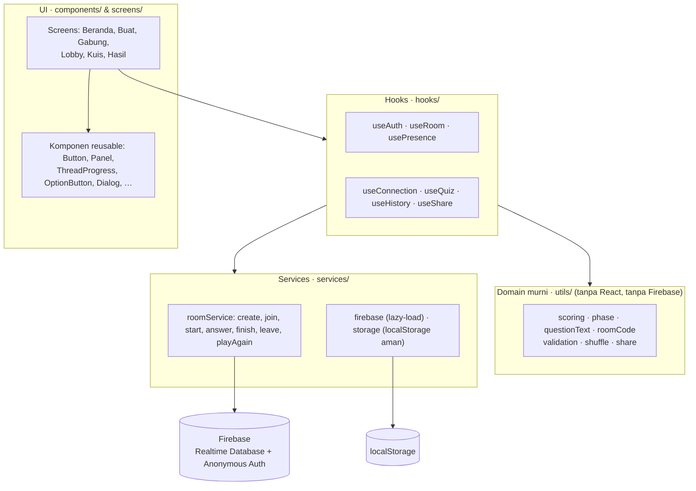
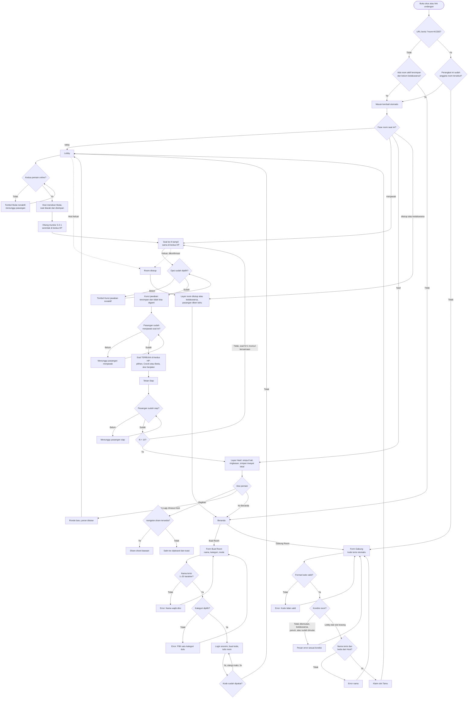
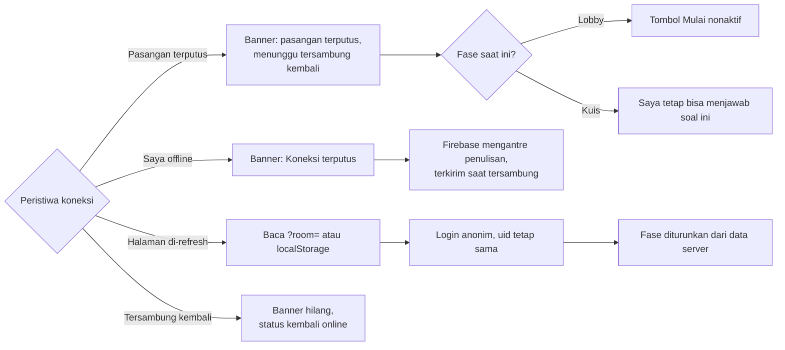
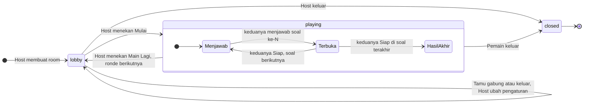
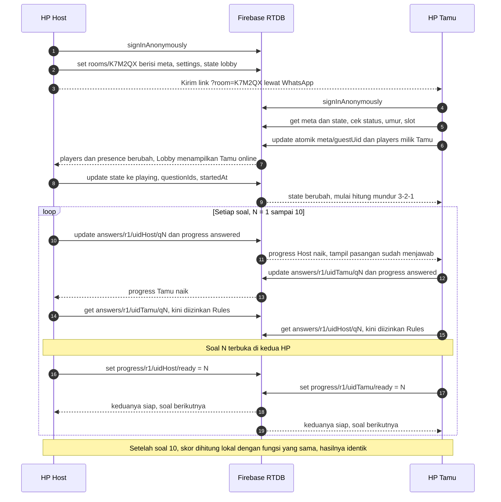

# System Design & Architecture: Kuis Pasangan · MVP v1.0

| | |
|---|---|
| **Versi dokumen** | 1.5 (Beranda baru tanpa "Cara main", sesuai PRD v1.5) |
| **Tanggal** | 22 November 2026 |
| **Acuan** | [01-PRD.md](01-PRD.md) v1.1 |
| **Fase berikutnya** | Fase 3: Project & Environment Setup |

> 💡 Diagram di dokumen ini memakai **Mermaid**. Diagram otomatis tampil di GitHub. Di VS Code, pasang ekstensi *Markdown Preview Mermaid Support* (`bierner.markdown-mermaid`), lalu buka preview dengan `Ctrl+Shift+V`.

---

## 1. Arsitektur

### 1.1 Lapisan aplikasi


**Aturan dependensi:** UI → Hooks → (Domain, Services). `utils/` tidak boleh meng-*import* React atau Firebase, sehingga logika skor, fase, dan validasi bisa diuji dengan Vitest tanpa jaringan.

### 1.2 Keputusan arsitektur (ADR ringkas)
| # | Keputusan | Alasan |
|---|---|---|
| ADR-1 | **Realtime Database**, bukan Firestore | *Presence* dan `onDisconnect` sudah bawaan, latensi rendah untuk update kecil yang sering, dan kuota gratis dihitung per bandwidth, bukan per operasi. |
| ADR-2 | **Anonymous Auth** | Pemain tidak perlu daftar, tetapi tetap punya `uid` yang stabil per perangkat. `uid` ini dipakai oleh Security Rules dan untuk masuk kembali setelah *refresh*. |
| ADR-3 | **Tanpa React Router.** Layar *diturunkan* dari data room | Data di server adalah satu-satunya sumber kebenaran: `layar = f(dataRoom, uidSaya, waktu)`. Kedua HP otomatis sinkron dan *refresh*-nya aman. URL hanya memuat `?room=KODE`. *Bundle* juga lebih kecil. |
| ADR-4 | Jawaban disimpan **per ronde**, **terkunci sejak dikirim**, dan **dibuka per soal oleh Rules** | Anti-intip ditegakkan di server: jawaban pasangan untuk sebuah soal baru bisa dibaca setelah keduanya menjawab soal itu, dan tidak bisa diganti setelah melihatnya. Ronde baru otomatis punya *path* yang bersih. |
| ADR-5 | Tidak ada *state library* (Redux/Zustand) | Aplikasinya kecil. Cukup custom hooks dan `useReducer` untuk *state* UI kuis. |
| ADR-6 | SDK Firebase di-*lazy-load* (`import()`) | Beranda tampil tanpa menunggu SDK, sehingga target LCP < 2,5 dtk dan JS ≤ 200 KB tercapai. |
| ADR-7 | Kode room dibuat lewat aturan **"tulis jika belum ada"** dan dicoba ulang jika bentrok | Klien tidak bisa membaca daftar room (privasi). Jika kode sudah dipakai, penulisan ditolak Rules, lalu klien membuat kode baru (maksimal 5 kali). |
| ADR-8 | Hitung mundur memakai `startedAt` dari server + `.info/serverTimeOffset` | Jam kedua HP bisa berbeda. Offset dari server membuat hitung mundur 3-2-1 benar-benar serentak. |

---

## 2. User Flow (langkah demi langkah)

### 2.1 Alur utama: Host
| # | Layar | Aksi pengguna | Respons sistem |
|---|---|---|---|
| 1 | **Beranda** | Membuka situs dan menekan **"Buat Room"** | Menampilkan form Buat Room. Nama terakhir sudah terisi dari `localStorage` jika ada. |
| 2 | **Buat Room** | Mengisi nama, memilih kategori dan mode, lalu menekan **"Buat Room"** | Validasi: nama 1–20 karakter dan kategori wajib dipilih. Jika gagal, error tampil inline dan fokus pindah ke field tersebut. |
| 3 | (proses) | — | Login anonim, membuat kode 6 karakter, menulis room (diulang jika kode bentrok). Kode disimpan ke `localStorage` dan URL menjadi `?room=K7M2QX`. |
| 4 | **Lobby** | Menekan **"Bagikan Link"** lalu mengirimnya lewat WhatsApp | *Share sheet* terbuka. Jika tidak tersedia, link disalin dan muncul *toast*. Slot pasangan menampilkan "Menunggu pasangan…". |
| 5 | **Lobby** | (Tamu bergabung) | Slot terisi "{nama Tamu} ● online". Host bisa mengubah kategori, mode, dan "Yang Ditebak". |
| 6 | **Lobby** | Menekan **"Mulai"** (aktif jika kedua pemain online) | Soal diacak, lalu `questionIds`, `status: playing`, dan `startedAt` disimpan di room. |

### 2.2 Alur utama: Tamu
| # | Layar | Aksi pengguna | Respons sistem |
|---|---|---|---|
| 1 | **Gabung** | Membuka link `?room=K7M2QX` | Login anonim, membaca `meta` dan `state`, lalu menampilkan undangan: *"{nama Host} ngajak kamu main. Kategori Santai, mode Tebak Aku."* |
| 1b | **Beranda → Gabung** | (alternatif) Menekan "Gabung Room" dan mengetik kode | Kode diubah ke huruf besar dan spasinya dibuang, lalu formatnya divalidasi. |
| 2 | **Gabung** | Mengisi nama lalu menekan **"Gabung"** | Validasi nama (wajib dan beda dari Host). Kondisi room dicek: tidak ditemukan, kedaluwarsa, penuh, atau sudah dimulai. |
| 3 | (proses) | — | Klaim slot Tamu (`meta/guestUid` lewat *transaction*), menulis `players/` dan `presence/`, lalu menyimpan kode ke `localStorage`. |
| 4 | **Lobby** | Menunggu | Pengaturan tampil *read-only* dengan pesan "Menunggu {nama Host} memulai…". |

### 2.3 Alur bersama: kedua pemain
| # | Layar | Aksi pengguna | Respons sistem |
|---|---|---|---|
| 7 | **Hitung mundur** | — | 3-2-1 berjalan serentak (ADR-8). |
| 8 | **Kuis: menjawab** | Memilih opsi lalu menekan **"Kunci jawaban"** | Jawaban dan `answered` disimpan dalam 1 *multi-path update*. Jawaban terkunci (Rules menolak penulisan ulang). Di HP pasangan muncul "{nama pasangan} sudah menjawab." |
| 9 | **Kuis: menunggu jawaban** | (jika menjawab lebih dulu) | Tombol berubah menjadi "Menunggu {nama pasangan} menjawab…". |
| 10 | **Kuis: terbuka** | — | Begitu keduanya menjawab, Rules membuka jawaban soal itu. Klien membaca jawaban pasangan untuk soal itu saja, lalu menampilkan penanda inisial, Cocok/Beda, dan skor berjalan "Cocok X dari Y". |
| 11 | **Kuis: siap** | Menekan **"Siap, soal berikutnya"** | `ready` naik 1. Soal yang tampil = min(`ready` kedua pemain), jadi soal berikutnya muncul serentak setelah keduanya siap. Yang lebih dulu melihat "Menunggu {nama pasangan} siap…". |
| 12 | **Hasil** | Di soal ke-10: **"Lihat hasil akhir"** | Setelah keduanya siap melewati soal ke-10: simpul hati, lalu ringkasan akhir. Skor dihitung lokal oleh fungsi murni yang sama, jadi identik di kedua HP. Riwayat disimpan sekali (id `KODE-rN`). |
| 13 | **Hasil** | **"Bagikan hasil"** / **"Main lagi"** (Host) / **"Ke beranda"** | Main Lagi: `round + 1`, peran ditukar, dan kedua pemain kembali ke Lobby. Tamu melihat pesan bahwa {nama Host} bisa memulai ronde berikutnya. |

### 2.4 Alur pengecualian
| Kode | Kondisi | Penanganan |
|---|---|---|
| E1 | Pasangan terputus | Banner "{nama pasangan} terputus, menunggu tersambung kembali…". Di Lobby, tombol Mulai nonaktif. Di Kuis, saya tetap bisa menjawab. |
| E2 | Perangkat saya offline | Banner "Koneksi terputus. Jawabanmu akan tersimpan saat tersambung kembali." Penulisan diantre otomatis oleh Firebase. |
| E3 | Halaman di-*refresh* atau dibuka ulang | Membaca `?room=` atau `localStorage`, login anonim (uid tetap sama), lalu fase diturunkan dari data server. |
| E4 | Pemain menekan "Keluar" di tengah kuis | Dialog konfirmasi, lalu `status: closed` dengan alasan `player-left`. Pasangan melihat layar "{nama pasangan} keluar dari permainan". |
| E5 | Host keluar dari Lobby | `status: closed` dengan alasan `host-left`, dan Tamu diberi tahu. |
| E5b | Tamu keluar dari Lobby | Slot Tamu dilepas (`guestUid` dihapus). Host melihat slot kosong lagi, dan room bisa diisi lagi. |
| E6 | Room berumur lebih dari 24 jam | Layar "Room sudah kedaluwarsa" dan `activeRoom` di `localStorage` dihapus. |
| E7 | Orang ketiga membuka link | Error "Room sudah penuh" di form Gabung. |
| E8 | Host membuka link undangannya sendiri | uid sama, jadi langsung masuk ke Lobby sebagai Host, bukan sebagai Tamu. |

---

## 3. Flowchart Alur Game



### 3.1 Penanganan koneksi (berlaku di semua fase room)


### 3.2 Siklus hidup room (state machine)

- Yang disimpan di database hanya `lobby`, `playing`, dan `closed`. Status di dalam `playing` **diturunkan** dari `progress/{ronde}`: soal yang tampil = min(`ready` Host, `ready` Tamu), dan langkahnya (menjawab, menunggu jawaban, terbuka, menunggu siap) dari `answered` kedua pemain (`deriveQuestionStep`).
- "Kedaluwarsa" juga diturunkan, yaitu dari `createdAt + 24 jam`, dan berlaku di semua status.

### 3.3 Sinkronisasi antar-perangkat (sequence)


---

## 4. Model Data

### 4.1 Struktur Realtime Database
```text
rooms/
└── K7M2QX/                         ← kode room (6 karakter)
    ├── meta/                       ← dibuat Host, sebagian besar tidak bisa diubah
    │   ├── hostUid: "uidHost"
    │   ├── hostName: "…"           ← nama yang diisi Host, untuk layar undangan
    │   ├── guestUid: "uidTamu"    ← diklaim Tamu (transaction)
    │   ├── createdAt: 1763800000000
    │   └── schemaVersion: 1
    ├── settings/                   ← hanya Host, hanya saat lobby
    │   ├── categoryId: "santai"
    │   ├── mode: "guess"
    │   └── targetUid: "uidHost"    ← Yang Ditebak
    ├── state/                      ← hanya Host (kecuali status → closed)
    │   ├── status: "playing"
    │   ├── round: 1
    │   ├── questionIds: ["santai-07", "santai-02", …]   ← 10 item
    │   ├── startedAt: 1763800123000
    │   └── closedReason: (opsional)
    ├── players/{uid}/              ← { name, role, joinedAt }
    ├── presence/{uid}/             ← { online, lastSeen } + onDisconnect
    ├── progress/r1/{uid}/          ← { answered: 0–10, ready: 0–10 }
    └── answers/r1/{uid}/           ← { "santai-07": "b", "santai-02": "d", … }
```
Perkiraan ukuran data per room kurang dari 3 KB, di bawah target 5 KB.

### 4.2 Pola langganan data di klien
Room **tidak bisa dibaca sekaligus**, karena tidak ada izin baca di level `rooms/{code}`. Klien berlangganan per bagian:

| Path | Kapan | Untuk apa |
|---|---|---|
| `meta`, `state`, `settings` | Sejak membuka room | Status, pengaturan, dan hitung mundur |
| `players`, `presence` | Setelah menjadi anggota | Lobby dan indikator online |
| `progress/{ronde}` | Selama `playing` | Progres pasangan live dan deteksi selesai |
| `answers/{ronde}/{uidSaya}` | Selama `playing` | Melanjutkan kuis setelah *refresh* |
| `answers/{ronde}/{uidPasangan}/{soal}` | **Per soal, setelah keduanya menjawab soal itu** | Membuka soal dan menyusun hasil akhir (sebelum itu ditolak Rules) |
| `.info/connected`, `.info/serverTimeOffset` | Sejak Firebase dimuat | Banner offline dan hitung mundur serentak |

### 4.3 Matriks akses (dasar Security Rules)
Prinsip: **tolak semuanya**, lalu buka seperlunya. "Anggota" berarti `auth.uid` sama dengan `meta.hostUid` atau `meta.guestUid`. Selain pembuatan room, **semua penulisan** mensyaratkan `now < meta.createdAt + 24 jam`.

| Path | Baca | Tulis | Validasi |
|---|---|---|---|
| `rooms` | ✗ (daftar room tidak bisa dilihat) | ✗ | — |
| `rooms/{code}` (pembuatan) | ✗ | Login, room **belum ada**, dan `meta.hostUid == auth.uid` | Kode cocok dengan `^[A-HJKMNP-Z2-9]{6}$`, punya `meta`, `settings`, dan `state` |
| `meta` | Semua yang login | `hostUid`, `hostName`, `createdAt`: tidak bisa diubah. `guestUid`: **klaim** jika kosong, status lobby, dan bukan Host. **Lepas** oleh pemiliknya saat lobby | `createdAt == now` saat dibuat |
| `settings` | Semua yang login | Host, status `lobby` | `categoryId` ada di daftar, `mode` adalah `guess` atau `match`, `targetUid` adalah Host atau Tamu |
| `state` | Semua yang login | Host (mulai dan Main Lagi). Anggota boleh mengubah **hanya** `status → closed` | `status` berupa enum, `questionIds` berisi 10 string, `startedAt == now` |
| `players/{uid}` | Anggota | `auth.uid == uid` dan `uid` adalah anggota | `name` string 1–20 karakter, `role` sesuai slot |
| `presence/{uid}` | Anggota | `auth.uid == uid` | `online` boolean, `lastSeen` number |
| `progress/{ronde}/{uid}` | Anggota | `auth.uid == uid`, status `playing` | `answered` 0–10 dan tidak pernah turun; `ready` 0–10, naik satu per satu, dan ≤ `answered` |
| `answers/{ronde}/{uid}` | Pemilik saja (seluruh node) | — | — |
| `answers/{ronde}/{uid}/{soal}` | Pemilik **ATAU** anggota, jika jawaban Host **dan** Tamu untuk soal itu sudah ada | `auth.uid == uid`, status `playing`, dan **belum pernah ditulis** (terkunci sejak dikirim) | Id soal valid, nilai `a` sampai `d` |

> **Implementasi:** [`database.rules.json`](../database.rules.json), diuji oleh 27 *integration test* di [`tests/integration/rooms.test.ts`](../tests/integration/rooms.test.ts) dengan beberapa pemain anonim sungguhan di Firebase Emulator (`npm run test:integration`).

### 4.4 Penyimpanan lokal (`localStorage`)
| Key | Isi | Catatan |
|---|---|---|
| `kp:v1:activeRoom` | `{ code, savedAt }` | Untuk masuk kembali otomatis. Dihapus saat room ditutup atau kedaluwarsa. |
| `kp:v1:history` | `HistoryEntry[]` (maksimal 5) | Disimpan idempoten berdasarkan `id = KODE-rN`. |
| `kp:v1:lastName` | `string` | Mengisi otomatis field nama. |

Semua nilai dibungkus `{ v: 1, data }`. Jika JSON rusak atau versinya berbeda, nilai dibuang. Akses `localStorage` memakai `try/catch` dengan *fallback* ke memori (FR-24).

### 4.5 Format bank soal (`data/questions.json`)
```json
{
  "version": 1,
  "categories": [
    {
      "id": "santai",
      "name": "Santai",
      "description": "Pemanasan ringan buat ketawa bareng.",
      "questions": [
        {
          "id": "santai-01",
          "text": "Kalau weekend tanpa rencana, {subjek} paling pengin…",
          "options": [
            { "id": "a", "text": "Rebahan maraton series" },
            { "id": "b", "text": "Jalan-jalan cari kuliner" },
            { "id": "c", "text": "Olahraga atau keluar rumah" },
            { "id": "d", "text": "Beres-beres dan produktif" }
          ]
        }
      ]
    }
  ]
}
```
**Token template:**
| Token | Perspektif "kamu" | Perspektif pasangan | Contoh |
|---|---|---|---|
| `{subjek}` | `kamu` | nama pasangan | "Kalau bete, {subjek} biasanya…" |
| `{milik}` | `mu` (menempel) | spasi + nama pasangan | "Lagu favorit{milik} saat ini?" menjadi "Lagu favoritmu…" atau "Lagu favorit {nama pasangan}…" |

Opsi jawaban **tidak boleh** memakai token, dan urutannya tetap sama untuk kedua pemain.

---

## 5. Struktur Data TypeScript (`types.ts`)

> Sumber kebenarannya [`src/types/index.ts`](../src/types/index.ts). Salinan di bawah diperbarui untuk v1.1 (dibuka per soal). Tipe yang berakhiran `Doc` adalah bentuk data **persis** seperti di Realtime Database.

```ts
/**
 * Tipe data Kuis Pasangan (docs/02-system-design.md §5).
 * Tipe berakhiran `Doc` = bentuk data persis di Firebase Realtime Database.
 */

// ═════════════════════════════════════════════
// 1. Bank soal (data/questions.json)
// ═════════════════════════════════════════════
export type CategoryId = 'santai' | 'deep-talk' | 'kebiasaan';
export type OptionId = 'a' | 'b' | 'c' | 'd';
/** Format `${CategoryId}-${2 digit}`, contoh "santai-03". */
export type QuestionId = string;

export interface QuestionOption {
  id: OptionId;
  text: string;
}

export interface Question {
  id: QuestionId;
  /**
   * Template teks soal. Token:
   * - `{subjek}` → "kamu" | nama pasangan
   * - `{milik}`  → "mu" (menempel) | " " + nama pasangan
   */
  text: string;
  /** Tepat 4 opsi berurutan a–d (dijaga parseQuestionBank). */
  options: readonly QuestionOption[];
}

export interface Category {
  id: CategoryId;
  name: string;
  description: string;
  // Ikon ditentukan di UI (CATEGORY_ICONS), bukan di data.
  questions: readonly Question[];
}

export interface QuestionBank {
  version: number;
  categories: readonly Category[];
}

// ═════════════════════════════════════════════
// 2. Mode & peran
// ═════════════════════════════════════════════
/** 'guess' = Tebak Aku, 'match' = Kita Mirip? */
export type GameMode = 'guess' | 'match';
export type PlayerRole = 'host' | 'guest';
/** Sudut pandang teks soal: 'self' → "kamu", 'partner' → nama pasangan. */
export type Perspective = 'self' | 'partner';

// ═════════════════════════════════════════════
// 3. Realtime Database: rooms/{code}/…
// ═════════════════════════════════════════════
export type Uid = string;
/** 6 karakter dari ROOM_CODE_ALPHABET. */
export type RoomCode = string;
/** "r1", "r2", … */
export type RoundId = `r${number}`;
export type RoomStatus = 'lobby' | 'playing' | 'closed';
export type ClosedReason = 'host-left' | 'player-left';

export interface RoomMetaDoc {
  hostUid: Uid;
  hostName: string;
  /** Tidak ada sampai Tamu bergabung (RTDB tidak menyimpan null). */
  guestUid?: Uid;
  /** Server timestamp (ms). */
  createdAt: number;
  schemaVersion: 1;
}

export interface RoomSettingsDoc {
  categoryId: CategoryId;
  mode: GameMode;
  /** Yang Ditebak (dipakai pada mode 'guess'). Default: hostUid. */
  targetUid: Uid;
}

export interface RoomStateDoc {
  status: RoomStatus;
  /** Dimulai dari 1, naik setiap Main Lagi. */
  round: number;
  /** Diisi saat Host menekan Mulai (10 item). */
  questionIds?: QuestionId[];
  /** Server timestamp untuk hitung mundur serentak. */
  startedAt?: number;
  closedReason?: ClosedReason;
}

export interface PlayerDoc {
  name: string;
  role: PlayerRole;
  joinedAt: number;
}

export interface PresenceDoc {
  online: boolean;
  lastSeen: number;
}

export interface ProgressDoc {
  /** Jumlah soal yang sudah dijawab (jawaban terkunci sejak dikirim), 0–10. */
  answered: number;
  /**
   * Indeks soal yang sudah siap dibuka pemain ini (0 di awal ronde). Naik 1 setiap menekan
   * "Siap" setelah sebuah soal terbuka. Soal yang tampil = min(ready kedua pemain).
   */
  ready: number;
}

/** answers/{roundId}/{uid} → { [questionId]: optionId } */
export type AnswerMap = Partial<Record<QuestionId, OptionId>>;

export interface RoomDoc {
  meta: RoomMetaDoc;
  settings: RoomSettingsDoc;
  state: RoomStateDoc;
  players?: Record<Uid, PlayerDoc>;
  presence?: Record<Uid, PresenceDoc>;
  progress?: Record<RoundId, Record<Uid, ProgressDoc>>;
  answers?: Record<RoundId, Record<Uid, AnswerMap>>;
}

// ═════════════════════════════════════════════
// 4. State di klien
// ═════════════════════════════════════════════
export interface PlayerView {
  uid: Uid;
  name: string;
  role: PlayerRole;
  online: boolean;
  answered: number;
  /** Lihat ProgressDoc.ready. */
  ready: number;
}

/** Gabungan semua langganan untuk satu room, sudah dinormalisasi oleh useRoom(). */
export interface RoomSnapshot {
  code: RoomCode;
  meta: RoomMetaDoc;
  settings: RoomSettingsDoc;
  state: RoomStateDoc;
  me: PlayerView;
  /** null jika Tamu belum bergabung. */
  partner: PlayerView | null;
  /** Jawaban saya di ronde aktif. */
  myAnswers: AnswerMap;
  /** Hanya soal yang sudah terbuka (keduanya menjawab); sisanya dikunci Security Rules. */
  partnerAnswers: AnswerMap;
}

/** Fase room. DITURUNKAN dari RoomSnapshot + waktu server, tidak disimpan. */
export type RoomPhase = 'lobby' | 'countdown' | 'answering' | 'result' | 'closed' | 'expired';

/**
 * Langkah di dalam satu soal (dibuka per soal):
 * menjawab → menunggu jawaban pasangan → terbuka → menunggu pasangan siap → soal berikutnya.
 */
export type QuestionStep =
  | { kind: 'answering'; index: number; partnerAnswered: boolean }
  | { kind: 'waiting-answer'; index: number }
  | { kind: 'revealed'; index: number }
  | { kind: 'waiting-ready'; index: number };

/** Layar tingkat atas. Isi layar 'room' ditentukan RoomPhase. */
export type AppView =
  | { name: 'home' }
  | { name: 'create' }
  | { name: 'join'; code?: RoomCode }
  | { name: 'connecting'; code: RoomCode }
  | { name: 'room'; code: RoomCode };

// ═════════════════════════════════════════════
// 5. Hasil
// ═════════════════════════════════════════════
export interface ComparisonRow {
  questionId: QuestionId;
  /** Mode guess: jawaban Yang Ditebak · mode match: jawaban Host. */
  first?: OptionId;
  /** Mode guess: tebakan Penebak · mode match: jawaban Tamu. */
  second?: OptionId;
  isMatch: boolean;
}

export interface ScoreSummary {
  matches: number;
  total: number;
  /** 0–100, bilangan bulat. */
  percent: number;
}

/** 4 = tertinggi. */
export type TierLevel = 1 | 2 | 3 | 4;

export interface ResultTier {
  level: TierLevel;
  /** Batas bawah persentase (inklusif). */
  minPercent: number;
  title: string;
  description: string;
}

export interface GameResult extends ScoreSummary {
  rows: ComparisonRow[];
  tier: ResultTier;
  /** Maksimal 3 soal yang tidak cocok, untuk "Ngobrolin ini, yuk". */
  talkingPoints: ComparisonRow[];
}

// ═════════════════════════════════════════════
// 6. Penyimpanan lokal
// ═════════════════════════════════════════════
export interface Versioned<T> {
  v: 1;
  data: T;
}

export interface ActiveRoomRef {
  code: RoomCode;
  savedAt: number;
}

export interface HistoryEntry {
  /** `${RoomCode}-${RoundId}`, agar penyimpanan idempoten. */
  id: string;
  playedAt: number;
  myName: string;
  partnerName: string;
  categoryId: CategoryId;
  mode: GameMode;
  percent: number;
  tierTitle: string;
}

// ═════════════════════════════════════════════
// 7. Error & hasil operasi
// ═════════════════════════════════════════════
export type NameError = 'empty' | 'too-long' | 'same-as-partner';

export type JoinError =
  'invalid-code' | 'not-found' | 'expired' | 'full' | 'already-started' | 'closed' | 'network';

export type CreateRoomError = 'code-exhausted' | 'network';

export type Result<T, E extends string> = { ok: true; value: T } | { ok: false; error: E };
```

### 5.1 Konstanta
```ts
export const QUESTIONS_PER_ROUND = 10;
export const NAME_MAX_LENGTH = 20;
export const ROOM_CODE_LENGTH = 6;
/** Tanpa 0/O, 1/I/L supaya tidak tertukar saat dibacakan lewat telepon. 31 karakter, ≈887 juta kombinasi. */
export const ROOM_CODE_ALPHABET = 'ABCDEFGHJKMNPQRSTUVWXYZ23456789';
export const ROOM_TTL_MS = 24 * 60 * 60 * 1000;
export const CREATE_ROOM_MAX_RETRY = 5;
export const COUNTDOWN_MS = 3000;
export const HISTORY_MAX = 5;
```

### 5.2 API fungsi domain murni (`utils/`): target unit test Fase 5
| Modul | Fungsi | Keterangan |
|---|---|---|
| `validation.ts` | `normalizeName(raw): string` | *Trim* dan meringkas spasi ganda. |
| | `validateName(raw, partnerName?): NameError \| null` | Cek kosong, terlalu panjang, dan sama dengan pasangan (tidak peka huruf besar/kecil). |
| `roomCode.ts` | `generateRoomCode(rng?)`, `normalizeRoomCode(raw)`, `isValidRoomCode(code)` | `rng` bisa diinjeksi agar hasil tes deterministik. |
| `shuffle.ts` | `shuffle(items, rng?)`, `pickQuestionIds(category, count, rng?)` | Fisher–Yates. |
| `questionText.ts` | `getPerspective(mode, myUid, targetUid): Perspective` | Mode guess: Yang Ditebak mendapat `self`, Penebak mendapat `partner`. Mode match: selalu `self`. |
| | `renderQuestionText(template, perspective, subjectName)` | Mengganti `{subjek}` dan `{milik}`. |
| `scoring.ts` | `compareAnswers(questionIds, first, second): ComparisonRow[]` | Jawaban kosong di salah satu sisi dihitung tidak cocok. |
| | `toPercent(matches, total)` | Jika `total = 0`, hasilnya 0. Dibulatkan dengan `Math.round`. |
| | `getTier(percent, mode): ResultTier` | Batas: 90, 70, 40, 0. |
| | `pickTalkingPoints(rows, max = 3)` | Soal yang tidak cocok, sesuai urutan soal. |
| | `buildResult(...)`: `GameResult` | Menggabungkan fungsi-fungsi di atas. |
| `phase.ts` | `isRoomExpired(createdAt, now)`, `getJoinBlocker(meta, state, myUid, now): JoinError \| null` | Dipakai di form Gabung. |
| | `deriveRoomPhase(input, serverNow): RoomPhase` | Inti *state machine* di §3.2. Hasil = keduanya `ready` ≥ jumlah soal. |
| | `currentQuestionIndex(mine, partner)` | Soal yang tampil = min(`ready` kedua pemain). |
| | `deriveQuestionStep(input): QuestionStep \| null` | Menjawab, menunggu jawaban, terbuka, atau menunggu siap. |
| | `revealedQuestionIds(ids, mine, partner)` | Soal yang sudah terbuka, untuk skor berjalan dan hasil akhir. |
| `share.ts` | `buildShareText(input): string` | Teks yang dibagikan (FR-17). |

---

## 6. Panduan UI/UX (revisi: putih, Deep Navy, Old Rose)

> 👀 **Pratinjau visual:** buka [design-preview.html](design-preview.html) di browser untuk melihat layar Beranda, Lobby, Kuis, dan Hasil. Tombol "Putar ulang momen hasil" memutar ulang animasi simpul hati.

### 6.1 Konsep: "Surat biru dan seutas benang"
Pengguna game ini adalah pasangan LDR yang bermain sambil video call, biasanya malam hari, dari dua HP di dua kota. Ada dua benda yang paling lekat dengan hubungan jarak jauh: **surat**, yaitu kata-kata yang dikirim dari jauh, dan **benang** yang menghubungkan dua orang yang terpisah. Desain ini meminjam keduanya:

- **Kertas putih, tinta navy, benang mawar.** Latarnya putih bersih dan teksnya Deep Navy seperti tinta pulpen. Judul dan soal memakai huruf serif, sehingga terbaca seperti kalimat dalam surat. Benangnya Old Rose: benang merah jodoh yang dilunakkan.
- **Benang adalah satu-satunya elemen yang mencolok.** Benang muncul di setiap layar, dan bentuknya berubah sesuai keadaan permainan:

| Layar | Bentuk benang | Artinya |
|---|---|---|
| Beranda | **Hero layar penuh.** Benang putus-putus menjuntai dari "Kamu, di sini" (titik terisi) ke "Dia, di sana" (lingkaran kosong), dengan **satu simpul longgar** di bawahnya seperti liontin. Simpul ini belum terikat | Kalian masih berjauhan. Simpulnya baru terikat menjadi hati di layar Hasil |
| Lobby | Selama menunggu, lingkaran kosong memancar. Saat pasangan masuk, titik-titik benang merapat menjadi benang utuh yang tegang dan avatarnya muncul | Pasangan sudah masuk room |
| Kuis | Dua titik bergerak dari ujung ke tengah sesuai jumlah jawaban. Jarak di antara keduanya putus-putus | Setiap jawaban mendekatkan kalian. Benang ini **menggantikan progress bar** |
| Menunggu pasangan | Titikmu sudah maju, titik pasangan menyusul begitu dia menjawab. Titik memancar sekali setiap ada jawaban baru | Menunggu pasangan menjawab soal ini |
| Hasil | Benang berangkat dari avatar kiri, membentuk **simpul hati**, lalu tiba di avatar kanan. Isi hati mengembang dan angka menghitung naik | Momen hasil dibuka bersama, dan menjadi **momen gerak terbesar** di game |

Elemen lainnya sengaja dibuat tenang: tanpa bayangan, tanpa gradien, tanpa ilustrasi dekoratif, dan tanpa emoji di antarmuka.

### 6.2 Palet warna
Hanya ada **tiga warna**: putih, **Deep Navy `#0B2545`**, dan **Old Rose `#E19AA6`**. Aturan pemakaiannya:

- **Navy untuk orang, teks, dan aksi:** semua teks, tombol utama, opsi terpilih, avatar dan titik pemain, serta cincin fokus.
- **Mawar untuk yang menghubungkan:** benang, simpul hati, opsi yang dipilih keduanya (cocok), ikon hati "Cocok", kotak undangan di Lobby, dan garis bawah tombol teks.
- **Old Rose tidak pernah dipakai sebagai warna teks**, karena kontrasnya di atas putih hanya 2,2 : 1.

Token lain hanyalah campuran navy atau mawar dengan putih, kecuali `bahaya` yang merupakan mawar yang diperdalam. Semua pasangan teks dan latar memenuhi WCAG 2.1 AA.

| Token | Hex | Asal | Pemakaian | Kontras |
|---|---|---|---|---|
| `kertas` | `#FFFFFF` | Putih | Latar semua layar, teks di atas navy | — |
| `tinta` | `#0B2545` | **Deep Navy** | Teks utama, tombol utama, avatar, opsi terpilih, angka hasil, fokus | 15,4 : 1 di putih |
| `mawar` | `#E19AA6` | **Old Rose** | Benang, simpul hati, ikon Cocok, penanda pemain kedua, garis opsi yang cocok | Dekoratif (2,2 : 1). Inisial navy di atasnya 6,9 : 1 |
| `tinta-terang` | `#2D445F` | Navy 86% | Hover dan *pressed* tombol utama | Teks putih 10,0 : 1 |
| `tinta-pudar` | `#4F6279` | Navy 72% | Teks sekunder, label, caption, teks tombol nonaktif | 6,3 : 1 di putih, 5,6 : 1 di `kabut`, 5,4 : 1 di `mawar-muda` |
| `bingkai` | `#8592A2` | Navy 50% | Garis tepi opsi dan input | 3,2 : 1 (syarat ≥ 3 : 1 untuk komponen UI) |
| `garis` | `#DDE0E5` | Navy 14% | Garis pemisah tipis | Dekoratif |
| `kabut` | `#F0F2F4` | Navy 6% | Latar opsi terpilih, *segmented control*, tombol nonaktif | `tinta` 13,7 : 1 |
| `mawar-muda` | `#F9EBED` | Mawar 20% | Latar opsi yang cocok, kotak undangan, seleksi teks | `tinta` 13,3 : 1 |
| `bahaya` | `#A3354B` | Mawar diperdalam | **Hanya** pesan error dan tombol aksi berbahaya | 6,6 : 1 di putih, teks putih di atasnya 6,6 : 1 |

**Cocok dan Beda tanpa hijau atau merah.** "Cocok" ditandai ikon hati mawar dan teks navy. "Beda" ditandai ikon lingkaran putus-putus dan teks berwarna `tinta-pudar`. Statusnya selalu ditulis sebagai teks, jadi tidak bergantung pada warna, dan sesuai prinsip "tidak ada hasil yang buruk".

**Penanda pemain di soal yang terbuka:** pemain pertama (Yang Ditebak, atau Host di mode Kita Mirip?) memakai lingkaran navy, sedangkan pemain kedua memakai lingkaran mawar. Beda gelap-terang keduanya jauh, sehingga tetap terbedakan oleh orang dengan buta warna, dan legenda di bawah opsi menyebutkan namanya.

> Dark mode masih di luar MVP. Karena semua warna memakai token, dark mode bisa ditambahkan di v1.1 dengan mengganti nilai token saja.

### 6.3 Tipografi
Dipakai dua keluarga huruf dengan peran yang jelas berbeda:

| Keluarga | Peran | Alasan |
|---|---|---|
| **Literata** (*variable*, sumbu `wght`) | "Suara surat": judul layar, teks soal, angka dan judul hasil, angka di riwayat | Serif buku yang hangat. Tetap kokoh di 16px dan elegan di 72px. Playfair Display ditolak karena klise romantis, sedangkan Fraunces dan Instrument Serif terlalu sering muncul di desain generik. |
| **Plus Jakarta Sans** (*variable*) | Antarmuka: tombol, opsi jawaban, label, status, teks isi | Karya foundry Indonesia (Tokotype). *x-height*-nya tinggi sehingga jelas di layar HP. |

Kedua font di-*self-host* lewat Fontsource (`@fontsource-variable/literata/wght.css` dan `@fontsource-variable/plus-jakarta-sans`) dengan `font-display: swap`. Browser hanya mengunduh subset yang dipakai (latin: Literata 52 KB, Jakarta 27 KB). Varian Literata dengan *optical size* (110 KB) tidak dipakai demi target LCP. File pratinjau memakai Google Fonts hanya agar praktis.

Ukurannya **sama di semua lebar layar**. Laptop tidak lagi memakai judul yang lebih besar, agar setiap layar muat tanpa scroll.

| Peran | Font | Ukuran / leading | Bobot |
|---|---|---|---|
| Hitung mundur | Literata | 96px | 500 |
| Angka hasil | Literata | 72 / 72px, *tracking* −0,03em | 500 |
| Judul Beranda | Literata | 44 / 46px, *tracking* −0,015em | 500 |
| Nama aplikasi di Beranda | Literata | 17 / 24px | 500 |
| Kode room di Lobby | Jakarta | 32px, *tracking* 0,2em | 700 |
| Judul layar, judul karakter | Literata | 28 / 33px | 500 |
| Teks soal | Literata | 24 / 31px | 500 |
| Judul bagian ("Ngobrolin ini, yuk"), judul dialog | Literata | 20–22px | 500 |
| **Semua teks lain**: isi, opsi jawaban, tombol, label, petunjuk, caption, label benang, kode di bilah atas | Jakarta (soal di daftar hasil: Literata) | **14 / 20px** | 400–700 |

**Aturan:**
- **Satu ukuran untuk semua teks selain judul (14px).** Hierarki dibuat lewat ketebalan (400/500/600/700) dan warna (`tinta` atau `tinta-pudar`), bukan ukuran.
- Khusus layar sentuh, teks di dalam input 16px. Safari iOS memperbesar layar saat fokus ke input di bawah 16px.
- Selalu *sentence case*. Tidak ada label berhuruf kapital semua.
- Judul tidak boleh diberi aksen pada satu kata saja.
- Panjang baris paragraf pembuka ≤ 46 karakter.
- Angka memakai `lining-nums tabular-nums`.

### 6.4 Layout, bentuk & gerak
- **Kolom:** satu kolom **rata kiri**, seperti surat. Lebar maksimal 560px di desktop. *Gutter* 20px di mobile dan 24px di ≥ 768px. Spasi memakai kelipatan 4px.
- **Muat satu layar.** Setiap layar ≤ 640px tingginya, yaitu laptop 1366×768 di zoom 100% dan kebanyakan HP, jadi tidak perlu di-*scroll*. Caranya:
  - Isi sekunder yang panjang memakai `Disclosure` yang bisa dibuka-tutup: daftar 10 jawaban di Hasil, serta riwayat di Beranda.
  - Lobby menampilkan pengaturan lengkap hanya setelah Tamu masuk.
  - Kategori berupa tiga kotak sejajar.
  - Benang digambar dengan 1 unit SVG = 1 piksel (`useWidth`), sehingga tingginya tidak ikut membesar di layar lebar.
  - Hasil pengukuran terakhir: tertinggi 637px (Buat Room dengan pesan error, lebar 390px). Layar Hasil sekitar 580px.
- **Beranda** adalah satu komposisi layar penuh (`ScreenLayout fill`): nama aplikasi di atas, benang bersimpul (`ThreadLoop`), judul, satu kalimat pembuka, lalu tombol di bawah dalam jangkauan jempol dan catatan privasi satu baris. Benang mengisi ruang yang tersedia (140–240px). Sisa ruang dibagi rata di atas benang dan di atas tombol, jadi komposisinya tetap utuh dari HP 360×640 sampai laptop. Screenshot: [screenshots/beranda.png](screenshots/beranda.png).
- **Action bar** menempel di bawah layar di zona jempol. Pemisahnya garis 1px `garis`, bukan bayangan, dengan `padding-bottom: env(safe-area-inset-bottom)`.
- **Radius bertingkat sesuai fungsi:**
  - Tombol: *pill* (999px)
  - Opsi jawaban dan pilihan kategori: 14px
  - Dialog: 24px
  - Avatar: lingkaran
- **Tanpa bayangan dan tanpa gradien.** Pemisahan memakai garis 1px atau ruang kosong.
- **Gerak: "benang yang hidup".** Semua gerak berpusat pada benang dan menceritakan jarak kalian: terulur, berayun selama longgar, menegang saat tersambung, berdenyut saat ada jawaban, lalu terikat menjadi simpul hati. Filmstrip semua momen: [screenshots/animasi-benang.png](screenshots/animasi-benang.png).
  - **Momen benang:**

    | Layar | Gerak | Waktu |
    |---|---|---|
    | Beranda | Benang tergambar dari "Kamu", melewati simpulnya, sampai ke "Dia". Lingkaran "Dia" muncul saat benang tiba, lalu memancar. Sesudahnya benang bernapas pelan | 1,6 dtk, lalu napas 5 dtk bolak-balik |
    | Gabung, Lobby menunggu | Benang terulur dari titik kiri, lalu titik kanan muncul. Selama masih longgar, benang berayun pelan | 0,9 dtk, lalu ayunan 3,6 dtk bolak-balik |
    | Lobby menunggu, Gabung | Lingkaran kosong memancar: sedang menunggu pasangan | Setiap 2,4 dtk |
    | Lobby, saat pasangan masuk | Titik-titik benang merapat menjadi benang utuh yang tegang. Avatar pasangan muncul memantul dan memancar sekali. Pengaturan naik menyusul | 0,7 dtk |
    | Hitung mundur | Benang melingkari angka, satu putaran per detik | 1 dtk per angka |
    | Kuis | Titik maju saat jawaban dikunci dan memancar sekali, termasuk titik pasangan saat dia menjawab | 0,3 dtk + pancaran 0,8 dtk |
    | Hasil | Benang mengikat simpul hati (0,2–1,8 dtk). Avatar kanan muncul saat benang tiba (1,6 dtk). Isi hati mengembang (1,65 dtk). Angka menghitung naik dari 0 (1,7–2,6 dtk). Judul naik (2,25 dtk), lalu sisanya (2,45 dtk) | Selesai sekitar 2,8 dtk |
  - **Gerak sebagai respons aksi:**
    - Opsi soal baru naik satu per satu (jeda 50ms), seperti baris surat yang ditulis berurutan.
    - Saat memilih, huruf terisi navy dan centang muncul memantul. Tombol dan pilihan sedikit mengecil saat ditekan.
    - Saat jawaban terbuka, penanda pemain meluncur dari sisinya masing-masing (pertama dari kiri, kedua dari kanan). Di opsi yang cocok, keduanya terlihat bertemu dan latarnya berubah mawar. Pesan menyusul, dan hati berdetak sekali jika cocok.
    - Dialog naik pelan dan latarnya meredup. *Disclosure*: panah berputar, isinya naik, dan tingginya ikut bergerak di browser yang mendukung `interpolate-size`.
    - Pesan error naik saat muncul. Keterangan pilihan (deskripsi kategori) memudar masuk saat berganti.
  - **Aturan:**
    - Animasi CSS memakai token `--animate-*` dan `--ease-*` di `src/styles/index.css`. Ada tiga kurva: `thread` untuk benang ditarik, `lembut` untuk elemen masuk, dan `pegas` untuk yang sedikit memantul.
    - Gerak yang tidak bisa dibuat dengan CSS di semua browser (benang menegang dan angka menghitung naik) memakai `useTween` (requestAnimationFrame). Hanya komponen kecil itu yang dirender ulang.
    - Hanya `transform`, `opacity`, dan goresan SVG benang yang dianimasikan. Tata letak tidak pernah bergeser, jadi aturan muat satu layar tetap terpenuhi.
    - Tidak ada animasi masuk per bagian di layar biasa dan tidak ada efek *hover* pada kartu. Perpindahan layar cukup *crossfade* 150ms.
    - Jika `prefers-reduced-motion` aktif, semua elemen langsung tampil di keadaan akhirnya: ayunan dan pancaran berhenti, dan angka langsung di nilai akhir.

### 6.5 Gaya bahasa (UX writing)
- Memakai **"aku–kamu"**: santai, kalimat pendek, dan *sentence case*.
- **Tanpa emoji di antarmuka.** Ikon kategori memakai Lucide bergaris navy: Santai → `Popcorn`, Deep Talk → `MessageCircleHeart`, Kebiasaan sehari-hari → `Coffee`.
- **Tanpa deretan info yang dipisah titik tengah.** Bukan "Santai · Tebak Aku", tapi "Santai, mode Tebak Aku".
- **Tanpa tanda panah di label tombol.** Nama aksi juga harus konsisten: tombol "Bagikan hasil" menghasilkan *toast* "Hasil disalin".
- Tidak pernah memakai kata **"salah"**. Gunakan **"beda"**.
- **Nama selalu berasal dari isian pemain.** Di dalam aplikasi tidak ada nama contoh. Di tabel di bawah, `{nama Host}`, `{nama pasangan}`, dan sejenisnya adalah placeholder. Jika nama tidak tersedia (misalnya data belum termuat), teksnya memakai "pasanganmu".
- Pesan error spesifik dan menunjukkan cara memperbaiki, misalnya "Nama maksimal 20 karakter" atau "Kode ini tidak ditemukan. Cek lagi 6 karakternya."

| Tempat | Teks |
|---|---|
| Judul Beranda | Seberapa kenal kamu sama dia? |
| Sub Beranda | Jawab soal yang sama dari HP masing-masing, sejauh apa pun jarak kalian. |
| Ujung benang di Beranda | Kamu, di sini / Dia, di sana |
| Catatan privasi (Beranda) | Yang disimpan cuma nama panggilan dan jawaban. |
| Undangan (layar Gabung) | {nama Host} ngajak kamu main. Kategori Santai, mode Tebak Aku. |
| Lobby Host, saat pasangan masuk | {nama pasangan} sudah masuk. Pilih kuisnya, lalu mulai bareng. |
| Lobby Tamu | {nama Host} yang memulai kuisnya. Tunggu sebentar, ya. |
| Petunjuk untuk Penebak | Tebak jawaban {nama yang ditebak} |
| Menunggu jawaban | Menunggu {nama pasangan} menjawab… |
| Soal terbuka (Penebak) | Cocok! Tebakanmu tepat. / Beda. {nama yang ditebak} memilih jawaban lain. |
| Soal terbuka (Yang Ditebak) | Cocok! {nama pasangan} menebak dengan tepat. / Beda. Tebakan {nama pasangan} belum tepat. |
| Menunggu siap | Menunggu {nama pasangan} siap… |
| Ringkasan hasil | {nama} dan {nama pasangan} cocok di 8 dari 10 jawaban. |
| Lobby Host, menunggu | Kategori Santai, mode Tebak Aku. Bisa diubah begitu pasanganmu masuk. |
| Peran di Lobby (Tebak Aku) | {nama yang ditebak} menjawab tentang dirinya, {nama penebak} menebak. **Tukar peran** |
| Hasil, di HP Tamu | {nama Host} bisa memulai ronde berikutnya. |
| Pasangan terputus | {nama pasangan} terputus. Kuis lanjut otomatis begitu dia tersambung lagi. |
| Room kedaluwarsa | Room ini sudah lewat 24 jam. Buat room baru untuk main lagi. |

### 6.6 Komponen reusable
| Komponen | Props utama | Catatan aksesibilitas dan perilaku |
|---|---|---|
| `Button` | `variant: primary \| outline \| ghost \| danger`, `loading`, `fullWidth`, `icon` | Tinggi 52px dan berbentuk *pill*. Saat `loading`, tampil spinner, `aria-busy`, dan tombol menolak klik (anti tap ganda). |
| `Panel` | `as`, `padding` | Pengganti `Card`. Datar, dengan garis tepi `garis` dan tanpa bayangan. Dipakai untuk dialog dan isi riwayat. |
| `ChoiceTile` | `icon`, `title`, `radio` | Kotak kategori, tiga sejajar. Memakai `role="radio"` dan `aria-checked`. Saat terpilih, garis tepi 2px `tinta`, latar `kabut`, dan centang. Deskripsi kategori yang aktif tampil di bawah grup (`hint` di `ChoiceGroup`). Kata tidak dipotong di tanda hubung. |
| `ChoiceGroup` | `legend`, `layout: stack \| tiles \| segmented`, `hint`, `error` | `fieldset` + `radiogroup`. Di bawahnya tampil error, atau jika tidak ada error, keterangan pilihan aktif. Keterangan dihubungkan lewat `aria-describedby`. |
| `Disclosure` | `summary`, `children` | `<details>` bawaan untuk isi sekunder yang panjang, agar layar utama muat tanpa scroll. |
| `OptionButton` | `letter: A–D`, `text`, `radio` | Opsi saat menjawab. Bulatan huruf terisi navy dan muncul centang di kanan, jadi status tidak hanya ditandai warna. Tinggi minimal 48px. |
| `RevealOption` | `letter`, `text`, `markers` | Opsi setelah dikunci atau terbuka (bukan tombol lagi). Penanda inisial: navy = Yang Ditebak/Host, mawar = Penebak/Tamu, plus teks untuk pembaca layar. Opsi yang dipilih keduanya berlatar `mawar-muda` dengan garis tepi `mawar`. |
| `RadioGroup` | `value`, `onChange`, `label` | Membungkus `OptionButton` dan `ChoiceTile`, dengan *roving tabindex* dan navigasi tombol panah. |
| `SegmentedControl` | `options`, `value`, `onChange` | Untuk pilihan Mode dan Yang Ditebak. Memakai `role="radiogroup"`, dan pilihan aktif diberi garis tepi navy. |
| `ThreadProgress` | `mine`, `partner`, `total`, `partnerName` | **Pengganti `ProgressBar`.** SVG-nya `aria-hidden`. Ada `role="progressbar"` dengan `aria-valuenow` (progres sendiri) dan `aria-valuetext="Kamu 3 dari 10, {nama pasangan} 6 dari 10"`. |
| `ThreadKnot` | `leftInitial`, `rightInitial`, `animate` | Simpul hati di layar Hasil. Benang memakai `stroke-dashoffset` dengan pola 1–2 agar tidak ada titik sisa di ujung. Isi hati dan avatar kanan muncul saat benang tiba. Dilewati jika `prefers-reduced-motion`. |
| `ThreadLoop` | `className` | Hero Beranda: benang bersimpul longgar yang mengisi tinggi wadahnya. Digambar lewat *mask* agar pola titiknya tetap, lalu bernapas (`scaleY` ke arah garis kedua ujung). SVG-nya `aria-hidden`. |
| `ThreadLink` | `connected`, `left`, `right`, `intro`, `waiting` | Benang di Gabung, Lobby, dan hitung mundur. `intro`: benang terulur saat layar dibuka. `waiting`: lingkaran kosong memancar. Ketegangan benang (0 = longgar, 1 = tegang) bergerak lewat `useTween`, termasuk jarak titik-titiknya. |
| `CountUp` | `value`, `suffix`, `delay`, `duration` | Angka hasil yang menghitung naik dari 0 (FR-14). Pembaca layar langsung mendapat angka akhirnya. |
| `TextField` | `label`, `value`, `error`, `hint`, `maxLength` | Label selalu terlihat. Memakai `aria-invalid` dan `aria-describedby`, plus penghitung karakter "12/20". |
| `Avatar` | `name`, `filled` | Lingkaran inisial. Nama lengkap tetap ditulis sebagai teks di dekatnya. |
| `RoomCodeChip` | `code`, `onCopy` | Dibacakan per karakter oleh *screen reader* (`aria-label="Salin kode room K 7 M 2 Q X"`). |
| `Banner` | `tone: info \| warning`, `message` | `role="status"`. Dipakai untuk status koneksi. |
| `Toast` | `message` | `aria-live="polite"`, hilang setelah 2,5 detik. |
| `ConfirmDialog` | `open`, `title`, `message`, `confirmLabel`, `onConfirm` | Elemen `<dialog>` bawaan: fokus terkunci di dalam dialog, bisa ditutup dengan Esc, dan fokus kembali ke pemicunya. |
| `Countdown` | `endsAt`, `onDone` | Angka 3-2-1 dengan Literata 96px navy, diumumkan lewat `aria-live="assertive"`. |
| `ScreenLayout` | `top`, `children`, `actions`, `fill` | Kerangka layar: *top bar*, konten yang bisa di-*scroll*, dan action bar yang menempel di bawah. `fill` membuat isi menjadi kolom flex setinggi layar (dipakai Beranda). |

### 6.7 Wireframe layar yang tidak ada di pratinjau
```text
┌─ GABUNG (dari link) ────────┐  ┌─ SOAL TERBUKA (Penebak) ────┐
│ ←                           │  │ ✕ Soal 4 dari 10 Cocok 3/4  │
│ [Nama] ─────────────── ○    │  │ ──●──────────────────●──    │
│ mengundang           kamu   │  │ Kamu 4/10  Pasangan 4/10    │
│                             │  │ Tebak jawaban [Nama]        │
│ [Nama] ngajak kamu main.    │  │ Minuman favorit [Nama]…     │
│ Kategori Santai,            │  │ ┃ A Kopi susu gula aren (S)(B)┃
│ mode Tebak Aku.             │  │ ┌ B Teh manis dingin      ┐ │
│                             │  │ ┌ C Boba                  ┐ │
│ Nama panggilanmu            │  │ ┌ D Air putih aja         ┐ │
│ ┌─────────────────────────┐ │  │ ● Jawaban [Nama] ○ Tebakan  │
│ │ Tulis namamu       0/20 │ │  │ ✓ Cocok! Tebakanmu tepat.   │
│ └─────────────────────────┘ │  │                             │
├─────────────────────────────┤  ├─────────────────────────────┤
│ [          Gabung         ] │  │ [ Siap, soal berikutnya   ] │
└─────────────────────────────┘  └─────────────────────────────┘
```
Screenshot dengan palet putih, Deep Navy, dan Old Rose: [screenshots/palet-navy-mawar.png](screenshots/palet-navy-mawar.png). Filmstrip gerak: [screenshots/animasi-benang.png](screenshots/animasi-benang.png). Beranda v1.5 (HP dan laptop): [screenshots/beranda.png](screenshots/beranda.png); Beranda di `palet-navy-mawar.png` dan `animasi-benang.png` masih versi sebelumnya. Screenshot `e2e-1` sampai `e2e-5` diambil dengan palet putih–biru sebelumnya; alurnya tetap sama.

### 6.8 Catatan review desain: pola generik yang sengaja dihindari
| Pilihan pertama yang generik | Diganti dengan | Alasan |
|---|---|---|
| Biru "SaaS" (`#2563EB`), teks abu-abu, kartu putih berbayangan | Deep Navy `#0B2545` untuk teks dan tombol, Old Rose `#E19AA6` hanya untuk benang dan kecocokan, tanpa bayangan | Navy terasa seperti tinta pulpen, bukan dashboard. Mawar dipakai hemat agar tetap romantis tanpa jadi manis berlebihan. |
| Progress bar standar | Benang dengan dua titik yang saling mendekat | Spesifik untuk LDR: menjawab berarti saling mendekat. |
| Angka persen besar dengan gradien sebagai sorotan hasil | Simpul hati dari benang mawar, lalu angka serif navy polos | Momen emosionalnya ada pada benang. Angkanya sudah cukup tegas tanpa hiasan. |
| Emoji kategori 🍿 💭 ☕ | Ikon garis Lucide berwarna navy | Emoji membawa warna lain di luar palet dan terasa seperti template. |
| Info dipisah titik tengah, panah di tombol, label kapital semua | Frasa biasa, tombol tanpa panah, *sentence case* | Ketiganya ciri khas halaman yang dibuat generator. |
| Merah dan hijau untuk Beda dan Cocok | Hati mawar untuk Cocok, lingkaran putus-putus dan tinta pudar untuk Beda | Sesuai prinsip "tidak ada hasil yang buruk" dan palet tiga warna. |
| Palet putih–biru (versi sebelumnya) | Putih, Deep Navy, Old Rose | Sesuai permintaan. Latar tetap putih, bukan krem, karena latar krem dengan aksen hangat termasuk pola desain AI yang umum. |

---

## 7. Keputusan yang Perlu Dikonfirmasi

| # | Pertanyaan | Rekomendasi |
|---|---|---|
| 1 | **Main Lagi** hanya bisa dimulai oleh **Host**? Tamu melihat "Menunggu {nama Host} memulai ronde baru". | **Ya.** Konsisten dengan aturan "Host yang mengatur". |
| 2 | **Tanpa React Router**, dengan layar diturunkan dari data room (ADR-3)? | **Ya** |
| 3 | Arah visual **"surat biru dan seutas benang"**: palet putih, Deep Navy, dan Old Rose, Literata + Plus Jakarta Sans, dan benang sebagai pengganti progress bar (lihat §6 dan [design-preview.html](design-preview.html))? | **Ya** |
| 4 | **Realtime Database** (bukan Firestore) di region Singapura? | **Ya** |
